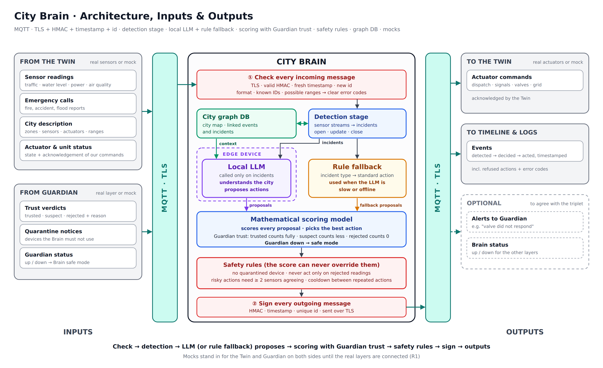

# City Brain: Architecture, Inputs and Outputs



## 1. What is decided

| Decision          | Detail                                                                                                                          |
| ----------------- | ------------------------------------------------------------------------------------------------------------------------------- |
| **Communication** | **MQTT** between all layers (IoT standard; the Twin works with real sensors)                                                    |
| **Security**      | **TLS** on every connection + **HMAC**, **timestamp** and **unique id** on every message                                        |
| **Validation**    | Every incoming message is also checked for **format, known IDs and possible ranges**, and rejected with a **clear error code**  |
| **Detection**     | A **detection stage** turns sensor streams into **incidents**; the LLM is called only when an incident opens, changes or closes |
| **Intelligence**  | A **local LLM** running on an **edge device** (no internet needed) proposes actions                                             |
| **Fallback**      | A **rule fallback** (incident type → standard action) proposes actions when the LLM is slow or offline                          |
| **Decision**      | A **mathematical scoring model** scores every proposal and picks the best action, weighting readings by **Guardian's trust**    |
| **Safety**        | **Safety rules** after the scoring that the score can never override                                                            |
| **Memory**        | A **city graph database** stores the city map and links related events together (see section 3)                                 |
| **Testing**       | **Mocks on both sides**: mock Twin and mock Guardian as inputs, mock actuators as output, so the Brain runs alone (R1)          |

**Flow:** Inputs → MQTT (TLS) → ① check → detection → local LLM (or rule fallback) proposes → scoring with Guardian trust → safety rules → ② sign → MQTT (TLS) → Outputs

---

## 2. Architecture

| #   | Block                          | Role                                                                                                                                                                                                 |
| --- | ------------------------------ | ---------------------------------------------------------------------------------------------------------------------------------------------------------------------------------------------------- |
| —   | **MQTT broker (TLS)**          | Carries every message between the three layers                                                                                                                                                       |
| 1   | **① Check incoming messages**  | Accepts a message only if: TLS connection · valid HMAC · fresh timestamp · new id · correct format · known IDs · value in the possible range. Otherwise rejected with an error code (2.1) and logged |
| 2   | **Detection stage**            | Turns sensor streams into incidents (2.2)                                                                                                                                                            |
| 3   | **City graph DB**              | Stores the city map, every event and every incident, and links them (section 3)                                                                                                                      |
| 4   | **Local LLM (edge device)**    | Called only on incidents; gets the incident + related events from the graph; proposes actions                                                                                                        |
| 5   | **Rule fallback**              | Proposes the standard action for the incident type; used when the LLM is slow or offline (2.3)                                                                                                       |
| 6   | **Mathematical scoring model** | Scores every proposal, weighting readings by Guardian's trust (2.4), and picks the best action                                                                                                       |
| 7   | **Safety rules**               | Final hard checks the score can never override (2.5)                                                                                                                                                 |
| 8   | **② Sign outgoing messages**   | Adds HMAC, timestamp and unique id to every message the Brain sends                                                                                                                                  |

### 2.1 Input validation and error codes

| Check     | Rejected when                                                         | Error code     |
| --------- | --------------------------------------------------------------------- | -------------- |
| Format    | A required field is missing or has the wrong type                     | `E_FORMAT`     |
| Signature | HMAC missing or wrong                                                 | `E_AUTH`       |
| Freshness | Timestamp older than the accepted window (e.g. 10 s)                  | `E_STALE`      |
| Replay    | Id already seen                                                       | `E_REPLAY`     |
| Known IDs | Sensor, zone or actuator not in the city description                  | `E_UNKNOWN_ID` |
| Range     | Value outside the sensor's possible range (e.g. negative water level) | `E_RANGE`      |

Every rejection is logged and shown on the timeline with its code, e.g. `E_RANGE: water-level-04 = -5 m`.

### 2.2 Detection stage

1. **Per sensor:** learns the sensor's normal level; one isolated spike is ignored, several abnormal readings in a row (or a value above the alert level) mark the sensor abnormal.
2. **Per zone:** simple rules combine signals into an incident type (flood = water abnormal + rising; fire = smoke and/or fire call; accident = call and/or traffic drop; jam = low speed outside rush hour) with a **confidence** from 0 to 1.
3. **Guardian's trust** is applied (see 2.4).
4. **Lifecycle:** open at confidence ≥ 0.5 twice in a row · update on new evidence · close below 0.25 · one open incident per zone + type.

Output: an incident (`type`, `zone`, `confidence`, `severity`, `evidence`, `verified`), sent to the graph DB, the LLM and the rule fallback. Full explanation: [`city-brain-architecture-improvements.md`](city-brain-architecture-improvements.md), annex.

### 2.3 Rule fallback

| Incident      | Standard action                                          |
| ------------- | -------------------------------------------------------- |
| Flood         | Open the upstream valve · close inbound traffic signals  |
| Fire          | Dispatch a fire unit · clear the route (traffic signals) |
| Accident      | Dispatch an ambulance · divert traffic                   |
| Traffic jam   | Retime traffic signals                                   |
| Power problem | Switch the grid to a backup line                         |

The rule fallback **always** proposes. If the LLM answers in time, its proposal is scored too, and the best one wins. If the LLM is slow (no answer within the time budget) or offline, the rule proposal is used alone. The city always gets a response.

### 2.4 Guardian's trust in the scoring

| Guardian verdict on a reading | Weight in the scoring |
| ----------------------------- | --------------------- |
| Trusted                       | 1 (counts fully)      |
| Suspect                       | Reduced (e.g. 0.3)    |
| Rejected                      | 0 (ignored)           |
| No verdict yet                | Reduced (e.g. 0.6)    |

**Safe mode when Guardian is down:** low-risk actions (traffic signals) are still allowed and marked *unverified*; risky actions (valves, grid, dispatch) need at least two different sensors to agree, otherwise they wait.

### 2.5 Safety rules

| Rule                                                                 | Example of what it blocks                                                                |
| -------------------------------------------------------------------- | ---------------------------------------------------------------------------------------- |
| Never use a **quarantined device**                                   | Opening `valve-port-main` after Guardian quarantined it → the next valve is used instead |
| Never act **only on rejected readings**                              | A fake flood reading with nothing else confirming it → no action                         |
| **Risky actions need ≥ 2 sensors agreeing** (valves, grid, dispatch) | Opening a valve on one water sensor alone → waits for a second signal                    |
| **Cooldown** between repeated actions in the same zone               | Switching the same traffic signal every few seconds → blocked for e.g. 60 s              |

A blocked action is never silent: the timeline shows `refused` with the rule that blocked it.

---

## 3. City graph database: connecting events

### Why

Events don't arrive alone. A fire call, a power spike and a traffic jam in neighbouring zones may be **one incident**. A reading that Guardian rejects must stay attached to the decision it blocked. A graph database stores these links, so the Brain can see **what is related to what**.

### What it stores

| Nodes                                                                             | Links (edges)                                                                                                                       |
| --------------------------------------------------------------------------------- | ----------------------------------------------------------------------------------------------------------------------------------- |
| **City map:** zones, sensors, actuators, units (from the Twin's city description) | zone **next to** zone · sensor **located in** zone · actuator **controls** zone                                                     |
| **Events:** readings, calls, verdicts, decisions, actions (from every message)    | reading **checked by** verdict · decision **triggered by** reading/call · action **executes** decision · event **happened in** zone |

### Example: one chain of linked events

```
(call: "smoke in zone 3") ─happened in─▶ (zone 3) ◀─located in─ (air-quality-12: smoke spike)
          │                                  │
          └──── triggered ────▶ (decision: fire in zone 3) ◀── checked by ── (verdict: trusted)
                                         │
                                    executes
                                         ▼
                              (action: dispatch fire-unit-1) ─▶ (ack: on scene)
```

### How the Brain uses it

| User                  | Question it answers                                                                                                     |
| --------------------- | ----------------------------------------------------------------------------------------------------------------------- |
| **Local LLM**         | "Which recent events in this zone and its neighbours are related?" → gets the linked events as context before proposing |
| **Scoring model**     | "Which actuators control this zone? Which zones are connected to it?"                                                   |
| **Timeline / report** | Shows the full cause → effect chain of any action, for the demo and the logs                                            |

### Technology (to choose)

| Option                           | Pros                                                                                 | Cons                                                                      |
| -------------------------------- | ------------------------------------------------------------------------------------ | ------------------------------------------------------------------------- |
| **Neo4j** (Community)            | The best-known graph DB, Cypher query language, built-in visual browser for the demo | Heavier (Java, ~1 GB RAM); better on a laptop than on a small edge device |
| **Memgraph**                     | Same query language as Neo4j, in-memory and fast                                     | Less known                                                                |
| **NetworkX** (Python, in memory) | Simplest, no server, enough for a small city                                         | Not a real database: no query language, saved to a file                   |

---

## 4. Inputs: what the Brain receives

### From the Twin (real sensors or mock)

| Input                        | Content                                                                            | Example                                                |
| ---------------------------- | ---------------------------------------------------------------------------------- | ------------------------------------------------------ |
| **Sensor readings**          | Live values per zone: traffic, water level, power load, air quality                | `water-level-04 · zone port · 2.4 m · 10:22:03`        |
| **Emergency calls**          | Incident reports: fire, accident, flood… (possibly free text)                      | `zone 3: "smoke from the substation"`                  |
| **City description**         | Zones, sensors and actuators, sent once at start                                   | `zone port: sensors […], actuators [valve-port-up, …]` |
| **Actuator and unit status** | State of valves, signals and units, plus the acknowledgement of each Brain command | `valve-port-up: opened` · `ambulance-2: on scene`      |

### From Guardian (real layer or mock)

| Input                  | Content                                                     | Example                                   |
| ---------------------- | ----------------------------------------------------------- | ----------------------------------------- |
| **Trust verdicts**     | Whether a reading or sensor can be trusted, with the reason | `water-level-04: rejected · out of range` |
| **Quarantine notices** | Devices the Brain must not use                              | `valve-port-main: quarantined`            |
| **Guardian status**    | Guardian up or down, so the Brain switches to a safe mode   | `guardian: offline`                       |

---

## 5. Outputs: what the Brain sends

| Output                       | To                                   | Content                                                                                         | Example                                                      |
| ---------------------------- | ------------------------------------ | ----------------------------------------------------------------------------------------------- | ------------------------------------------------------------ |
| **Actuator commands**        | Twin (real actuators or mock)        | The chosen response: dispatch units, traffic signals, valves, grid switches                     | `open valve-port-up 80 %` · `dispatch ambulance-2 to zone 3` |
| **Events**                   | Timeline screen + log files (R2, R3) | Every step, timestamped: detected → decided → acted, or refused because of an untrusted reading | `10:22:04 flood detected at port → valve opened`             |
| *Optional:* **Alerts**       | Guardian                             | Problems the Brain notices, e.g. an actuator that doesn't respond                               | `valve-port-up did not respond`                              |
| *Optional:* **Brain status** | All layers                           | Brain up or down                                                                                | `brain: online`                                              |

*Optional outputs are to be agreed with the other two teams.*

---

## 6. Message format (proposal, to confirm with the triplet)

Every message, in both directions, carries the same security fields:

| Field       | Purpose                                                                                |
| ----------- | -------------------------------------------------------------------------------------- |
| `id`        | Unique message id, so a replayed message is rejected                                   |
| `timestamp` | Time sent, so an old message is rejected (e.g. older than 10 s)                        |
| `source`    | Which layer sent it                                                                    |
| `hmac`      | Seal computed over the whole message with the shared secret, so any change is detected |

**Input example: sensor reading from the Twin**

```json
{
  "id": "twin-000182",
  "timestamp": "2026-11-14T10:22:03Z",
  "source": "twin",
  "sensor_id": "water-level-04",
  "zone_id": "port",
  "type": "water_level",
  "value": 2.4,
  "unit": "m",
  "hmac": "9f2c…e81a"
}
```

**Input example: verdict from Guardian**

```json
{
  "id": "guardian-004521",
  "timestamp": "2026-11-14T10:22:03Z",
  "source": "guardian",
  "sensor_id": "water-level-04",
  "verdict": "rejected",
  "reason": "out of range",
  "hmac": "41ab…07cd"
}
```

**Output example: command from the Brain**

```json
{
  "id": "brain-000042",
  "timestamp": "2026-11-14T10:22:04Z",
  "source": "brain",
  "actuator_id": "valve-port-up",
  "action": "open",
  "params": { "percent": 80 },
  "hmac": "c7d0…5b19"
}
```

---

## 7. MQTT topics (proposal, to confirm with the triplet)

| Topic                                   | Direction              | Content                                     |
| --------------------------------------- | ---------------------- | ------------------------------------------- |
| `city/{zone}/sensor/{type}/{sensor_id}` | Twin → Brain, Guardian | Sensor readings                             |
| `city/{zone}/call`                      | Twin → Brain, Guardian | Emergency calls                             |
| `twin/meta`                             | Twin → Brain, Guardian | City description                            |
| `twin/status/{actuator_id}`             | Twin → Brain           | Actuator / unit status and acknowledgements |
| `guardian/verdict/{sensor_id}`          | Guardian → Brain       | Trust verdicts                              |
| `guardian/quarantine/{device_id}`       | Guardian → Brain, Twin | Quarantine notices                          |
| `guardian/status`                       | Guardian → all         | Guardian up / down                          |
| `brain/cmd/{actuator_id}`               | Brain → Twin           | Actuator commands                           |
| `brain/event`                           | Brain → Timeline       | Events for the timeline and logs            |

---

## 8. Mocks

| Mock                    | Replaces        | Used for                                                                                       |
| ----------------------- | --------------- | ---------------------------------------------------------------------------------------------- |
| **Mock Twin (sensors)** | Twin inputs     | Plays scenario readings and calls over MQTT                                                    |
| **Mock Guardian**       | Guardian inputs | Sends verdicts, quarantines and up/down status (e.g. "reject this sensor", "Guardian offline") |
| **Mock actuators**      | Twin outputs    | Receives Brain commands and sends back acknowledgements                                        |

The mocks use exactly the message format and topics above, so switching to the real layers only means connecting to the shared broker.

---

## 9. Still to agree

- [ ] Final topic names
- [ ] Final message fields and units
- [ ] Where the broker runs, and the TLS certificates
- [ ] How the HMAC secrets are shared (one per pair of layers)
- [ ] Accepted timestamp window (e.g. 10 s)
- [ ] Verdict values and reasons (Guardian)
- [ ] Command and acknowledgement format (Twin)
- [ ] Whether the optional outputs (alerts, Brain status) are used
- [ ] With the Twin team: the city description includes which zones are next to each other and which actuator controls which zone (needed for the graph)
- [ ] Inside our team: graph DB technology (Neo4j, Memgraph or NetworkX) and which machine runs it
