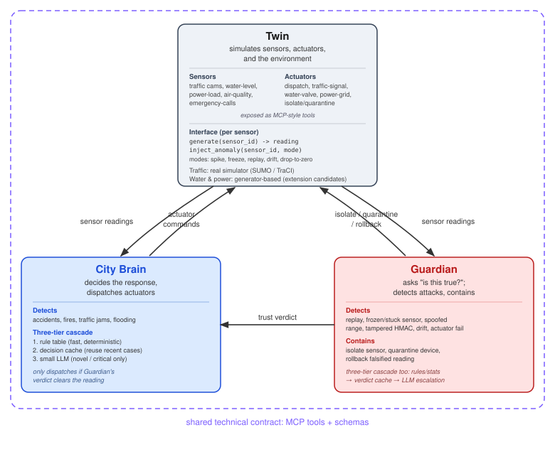
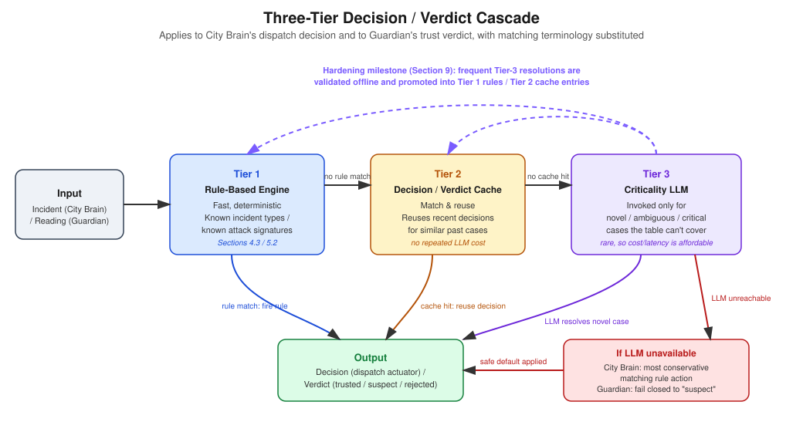

# City Brain Convergence: Solution Proposal

---

## 1. Executive Summary

City Brain Convergence asks three independently-built teams to each deliver one layer of a smart-city system: a **Twin** (simulated city), a **City Brain** (decision engine), and a **Guardian** (trust/security watchdog), that then have to work as a single live system despite never having seen each other's code. Since the layer assignment for this team isn't known yet, this proposal covers the design, technology choices, and security approach for all three layers, so development can start immediately once one is confirmed.

One idea runs through most of the choices here: the contract between layers matters at least as much as any single layer's internal design, since each layer must work with a partner it has never met, and keep working when the data it depends on is being deliberately falsified.

---

## 2. Challenge Understanding

The system is split into three layers that get merged and demonstrated together:



City Brain and Guardian both read the Twin's sensor stream and can call its actuator tools; City Brain only dispatches after Guardian's trust verdict clears the triggering reading.

Teams are grouped into randomly-assigned triplets (one team per layer) and get re-paired with different partners more than once, so no team can rely on a private understanding with a specific partner; every layer must work against any implementation of the other two, as long as it follows the shared contract, including when the sensor data is being deliberately falsified.

Interoperability and a correct response to falsified data carry more scoring weight than any individual layer's feature count. A layer that's impressive but hard for a partner to integrate with, or that falls over under an attack it wasn't specifically coded for, is a weaker solution than a simpler layer built on a clear, well-documented contract.

---

## 3. Layer Design: Twin

### 3.1 Responsibilities

The Twin simulates five sensor types (traffic cameras, water-level sensors, power-load meters, air-quality monitors, emergency-call feeds) and five actuator types (police/ambulance dispatch, traffic-signal control, water-valve control, power-grid switching, device isolation/quarantine), exposing every reading and action as a callable **MCP-style tool**.

### 3.2 Design Approach

Rather than integrating a full domain simulator immediately, each sensor starts as a **pluggable signal generator** behind a common interface. Ready-made simulation libraries exist for a few of these domains, and those get brought in once this lightweight interface is working:

```
generate(sensor_id) -> reading
inject_anomaly(sensor_id, mode)   # spike | freeze | replay | drift | drop-to-zero
```

`freeze` and `replay` are kept as separate modes rather than one, since they are different attacks with different footprints: `freeze` emits a fresh, correctly-HMAC'd envelope every tick with a value that stops changing, while `replay` resends a previously-seen envelope, old HMAC and all. A nonce/timestamp check catches `replay` but has nothing to say about `freeze`, which needs a separate check on the value's own variance over time.

Each generator produces a baseline pattern (flat, daily sine wave, or Poisson event process depending on sensor type) plus some noise, producing a working, controllable Twin quickly so City Brain and Guardian integration doesn't wait on the simulation core.

The `inject_anomaly` hook isn't decorative: it's how the Guardian design gets tested during development, and the same kind of thing organizer-run adversarial testing will exercise from the outside, so building it in early keeps that path from being an afterthought.

### 3.3 Domain Simulator Integration

If this team is assigned the Twin layer, traffic is the one domain worth backing with a real simulator rather than a synthetic generator: SUMO, driven via its TraCI Python API, gives real vehicle-flow and congestion modeling, so a signal change from City Brain produces a genuine downstream change rather than a scripted number. Water (WNTR/EPANET) and power (pandapower) are credible extensions of the same idea if time allows after traffic is working, but are not committed to up front, since each requires defining a network topology before producing anything.

None of these engines naturally answers a per-sensor, on-demand `generate(sensor_id)` call the way the lightweight generator does: TraCI advances the whole simulation by a fixed step and then lets a caller read state, rather than sampling one sensor on demand. The resolution is a single background loop that advances the engine on a fixed tick and writes the result into an in-memory cache, with the per-sensor async tool functions only ever reading from that cache. This keeps the synchronous, whole-network solver off the request path entirely.

**Sequencing, so this doesn't put the core system at risk:** every sensor, traffic included, first ships behind the lightweight generator interface described above, with the `inject_anomaly` hook in place, so a fully working, MCP-exposed Twin exists before any simulator work starts. SUMO is then defined and validated against a local City Brain/Guardian in isolation, behind the same MCP tool signatures, before being exposed to any partner. If it isn't passing its own tests in time, traffic reverts to its generator; since the interface is identical either way, that fallback is a config change, not a rewrite.

### 3.4 Actuators

Actuators are modeled as state-mutating tool calls (e.g. `set_traffic_signal(intersection_id, state)`) that update the Twin's internal state and are reflected in later readings from affected sensors, making the "dispatch changes the Twin" loop a real effect rather than a cosmetic one.

---

## 4. Layer Design: City Brain

### 4.1 Responsibilities

City Brain consumes the Twin's live sensor stream, detects real-world incidents (accidents, fires, traffic jams, flooding), decides the correct operational response, and dispatches the matching actuator, but only after checking Guardian's trust verdict on the triggering reading.

### 4.2 Incident Detection

Each incident type is detected from a distinct pattern over the sensor stream rather than a single reading, so one noisy sample doesn't trigger a false dispatch:

| Incident | Detection pattern |
| --- | --- |
| **Flooding** | Water-level reading exceeds a zone threshold and stays above it for several consecutive readings, not just a single spike |
| **Fire** | Correlated signal across air-quality (smoke/particulate spike) and, where available, the emergency-call feed for the same zone within a short window |
| **Traffic accident** | Emergency-call feed reporting an incident in a zone, corroborated by a sudden drop in traffic-camera flow/speed for that zone |
| **Traffic jam** | Sustained low average speed / high vehicle density from traffic cameras over a rolling window, distinguishing a jam from ordinary rush-hour variance |

Requiring a sustained or corroborated signal, rather than a single reading, is a small first line of defense against spoofed data on its own, alongside Guardian's dedicated trust verdict.

### 4.3 Decision Engine: Three-Tier Cascade

A plain rule table is easy to explain but limited to cases anticipated in advance. A small cascade is used instead, so that ordinary cases stay fast and deterministic while less common or ambiguous ones still get a considered response rather than being handled badly or not at all. Guardian's trust-verdict logic, described later in this document, follows the same pattern with "decision" replaced by "verdict":



#### Tier 1: Rule-Based Decision

The everyday path: a decision table covering all four incident types.

```
IF incident_type == "flooding"        AND guardian_trust(reading) >= THRESHOLD
  THEN dispatch("water_valve_control", target=affected_zone)
IF incident_type == "fire"             AND guardian_trust(reading) >= THRESHOLD
  THEN dispatch("emergency_dispatch", unit="fire", target=affected_zone)
IF incident_type == "traffic_accident" AND guardian_trust(reading) >= THRESHOLD
  THEN dispatch("emergency_dispatch", unit="ambulance", target=affected_zone)
IF incident_type == "traffic_jam"      AND guardian_trust(reading) >= THRESHOLD
  THEN dispatch("traffic_signal_control", target=affected_intersection)
```

This covers most cases with no external dependency. It's also easy to check by hand, which helps when debugging or explaining what the system did. If the ruleset grows past roughly 15 conditions (e.g. severity tiers per incident type), the plan is to move to a small rules-engine library (e.g. `json-logic`) rather than a nested if/else tree, mainly for maintainability.

#### Tier 2: Decision Cache

Before going further, a check runs for whether a similar-enough incident (same type, comparable severity/signature) was resolved recently, and reuses that decision instead of recomputing it. This handles recurring edge cases cheaply, and keeps working even if the tier below is temporarily unreachable, since a cached decision needs no external call. Entries expire after a short, fixed window and are invalidated immediately if the Twin's state for that zone changes (an actuator fires, a new reading contradicts the cached case), so the cache reflects the current situation rather than a decision made against conditions that no longer hold.

#### Tier 3: Criticality LLM

Cases that don't resolve in the first two tiers, genuinely novel patterns, competing incidents in the same zone, or an ambiguous severity call, get passed to a small LLM invoked for that one case. Since this only applies to a minority of cases, the added latency and cost stay manageable in a way they wouldn't if every decision went through it.

#### Fallback When the LLM Is Unavailable

If this tier can't be reached, City Brain doesn't stall: it falls back to the most conservative rule action that matches the incident type, dispatches it, and flags the case for later review. The system ends up slightly less optimal in that moment, but it still responds safely rather than not responding at all. Cases resolved this way are candidates for turning into permanent rules or cache entries later on, so the deterministic tiers gradually pick up what the escalation tier learns.

### 4.4 Guardian Gating

Every dispatch decision first checks Guardian's trust verdict for the triggering reading; if flagged as untrusted, City Brain suppresses the action and logs Guardian's reason, so it never acts on a reading Guardian hasn't cleared.

### 4.5 Incident Lifecycle and Idempotency

City Brain tracks each detected incident as a stateful object (`open` → `dispatched` → `resolved`) keyed by zone and incident type, rather than re-evaluating raw readings on every tick. This keeps a sustained flood or jam from triggering duplicate dispatches, and leaves a clear record of what was decided and when.

### 4.6 Extensibility

New incident types are added by defining a new detection pattern and a new row in the decision table; the dispatch mechanism, gating, and lifecycle tracking don't change. Coverage also grows on its own as resolved edge cases fold back into the rule table over time.

---

## 5. Layer Design: Guardian

### 5.1 Responsibilities

Guardian watches the same sensor stream as City Brain and independently evaluates whether each reading is trustworthy, detecting sensor malfunction, actuator failure, spoofed data, and cyberattacks, and can isolate a sensor, quarantine a device, or roll back a falsified reading.

### 5.2 Design Approach: Three-Tier Cascade

Guardian's job is harder than City Brain's by nature: "is this reading trustworthy" is open-ended, and the hardest cases are attacks nobody wrote a rule for yet. The same cascade applies here, adapted from decisions to trust verdicts.

#### Tier 1: Rule-Based Detection

Deterministic checks mapped to each threat that can be named in advance:

| Threat | Detection mechanism |
| --- | --- |
| **Message replay** | Reject a reading whose exact timestamp/nonce pair has already been seen (an old, correctly-HMAC'd envelope resent) |
| **Frozen / stuck sensor** | Reject a reading whose value has shown near-zero variance over a rolling window longer than expected; unlike a replay, the envelope here is fresh and correctly HMAC'd, only the value never changes |
| **Spoofed / out-of-range data** | Reject a reading outside the sensor's physically possible range |
| **Tampered / unauthenticated** | Reject a reading with a missing or invalid HMAC |
| **Sensor malfunction / drift** | Statistical check (e.g. z-score / EWMA) against that sensor's own recent history |
| **Actuator failure** | Actuator's reported post-command state doesn't match the commanded state within a timeout |

The HMAC and replay checks catch tampering in transit; they do nothing against a reading falsified at the source but carrying a correctly-computed HMAC, which is the shape Phase 2's scenarios are expected to take. That's what the frozen/stuck check, range and drift checks, and Tier 3 are for.

A trained ML model is deliberately not used here: Phase 2 scenarios are organizer-provided and unseen in advance, and a model trained on the Twin's own synthetic data risks fitting that generator's quirks rather than the real attack patterns. Rules and simple statistics are easier to reason about and debug when something goes wrong.

#### Tier 2: Verdict Cache

A reading pattern that closely matches one resolved recently reuses that prior verdict, with one asymmetry: only `suspect`/`rejected` verdicts are cached and reused automatically. A `trusted` verdict from Tier 3 is never cached as a standing exemption; each new occurrence is escalated again. This means a previously-seen attack is rejected cheaply on repeat, while a single incorrect `trusted` judgment can't become a standing bypass.

#### Tier 3: Criticality LLM Escalation

Readings that Tier 1 doesn't flag but that don't look clearly normal either, for example a small anomaly spread across two or three sensors that's individually within range but suspicious together, get passed to a small LLM for a judgment call. This is the only place an LLM sits in Guardian's pipeline, and it's reserved for the cases where rules and statistics genuinely run out of coverage.

#### Fallback When the LLM Is Unavailable

Guardian fails closed: if this tier can't be reached, an escalated reading comes back as `suspect` rather than `trusted` by default, and City Brain's gating already treats a non-trusted verdict conservatively. Don't-trust-until-checked holds even with this tier down, at the cost of occasional overcaution rather than unsafe trust. Confirmed resolutions become candidates for permanent rules only after checking against past logs, so a one-off judgment call doesn't quietly become permanent.

### 5.3 Trust Verdict Interface

Guardian exposes a `get_trust_verdict(reading_id)` tool that returns a verdict (`trusted` / `suspect` / `rejected`) plus a reason code, which City Brain checks before acting. This interface is part of the shared contract between the two layers.

### 5.4 Containment and Rollback

On a rejected verdict, Guardian takes one of three concrete actions rather than only logging the rejection:

- **Isolate:** call the Twin's `isolate_sensor` tool so the compromised sensor's readings are excluded from City Brain's stream until cleared.
- **Quarantine:** call the Twin's `quarantine_device` tool for a suspected compromised actuator, blocking further commands to it.
- **Rollback:** where the Twin exposes a revert-to-last-known-good tool, Guardian calls it on the affected sensor, correcting the Twin's actual state at the source. Where no such tool exists, Guardian does not fabricate a replacement value for City Brain; it treats the reading as isolated (excluded, not silently substituted), since a fabricated value is itself unverified data, and Guardian's job is not to become a second, unaudited sensor.

These are real actions, not just log entries. Isolation and rollback both mean City Brain may briefly see no fresh reading rather than a fabricated one; incident detection already requires a sustained or corroborated signal, so a brief gap in one sensor doesn't block detection through the others.

### 5.5 Guardian Self-Resilience

Because an attacker who can fool Guardian defeats the whole system's trust model, no single detection signal is relied on alone: the rule checks and statistical checks in Tier 1 run independently, and a verdict needs agreement between them, so either alone can reject a reading, but both must agree for `trusted`. The fail-closed default extends the same idea to the escalation tier.

### 5.6 Extensibility

New attack signatures are added as rule entries without touching the statistical checks, and thresholds are configured per sensor type rather than hardcoded, so tuning against a new partner's Twin is configuration, not code. Resolutions from the escalation tier feed new entries into the rules and cache over time, once checked, so coverage compounds round over round rather than staying fixed at whatever was anticipated going in.

---

## 6. Shared Technical Contract

Since layer partners are assigned rather than chosen, one of the more useful things to get right early is a **frozen, versioned API contract**, kept in the repository's `contract/` directory before it's known who the partners will be.

**Contract contents:**

- **OpenAPI specification** for all REST/tool endpoints (readings, actuator calls, trust-verdict queries)
- **JSON Schema** for every message type: sensor reading (`reading_id`, `sensor_id`, `type`, `value`, `unit`, `timestamp`, `signature`, `nonce`), actuator command, trust verdict. `reading_id` is the field `get_trust_verdict(reading_id)` depends on, so it's defined here rather than assumed.
- **MCP tool manifest** listing every callable tool with its schema, generated from the underlying tool definitions so it can't drift out of sync with the code
- A short **integration guide**, in plain language, describing how to authenticate, subscribe to the live stream, and interpret a trust verdict, written for a partner who's never seen the codebase

A minimal sensor-reading message looks like this:

```json
{
  "reading_id": "twin-7f3a-000182",
  "sensor_id": "water-level-04",
  "type": "water_level",
  "value": 2.31,
  "unit": "m",
  "timestamp": "2026-11-14T10:22:03Z",
  "signature": "base64(...)",
  "nonce": "9c1e2f..."
}
```

Organizers share Detailed Specifications on layer-assignment day (22 September); this draft schema is a starting point reconciled against that real spec on assignment, then re-validated with each newly-matched partner, not a substitute for it. The contract is versioned in git and append-only for the duration of an active integration window with a given partner, not permanently: a triplet formed at the second matching round starts from the current contract state, not a promise made to an earlier partner.

---

## 7. Technology Stack and Justification

The choices below are aimed at two things: a contract an unfamiliar partner can integrate against without much back-and-forth, and a system that keeps working under scenarios that weren't specifically anticipated, ahead of raw performance or novelty that a small team can't really afford to chase.

| Decision | Choice | Why |
| --- | --- | --- |
| **Language/framework** | Python 3.11 + FastAPI | Async-native for streaming; generates OpenAPI docs along the way; one language for both rule logic and statistics |
| **Real-time transport** | WebSockets | Low integration cost: a client is a few lines in any language, no broker to stand up |
| **MCP tool exposure** | FastMCP | MCP compliance with little boilerplate for a team new to the protocol |
| **Shared contract format** | JSON Schema + OpenAPI | Language-agnostic, browser-readable, generated from FastAPI rather than hand-maintained |
| **Containerization** | Docker + docker-compose | A partner brings the system up with `docker compose up`, without Kubernetes overhead |
| **Message integrity** | HMAC signing + timestamp/nonce | Guards against spoofed/replayed readings without certificate management between partners; HMAC needs only a shared secret per pair, no PKI |
| **Sensor simulation (Twin)** | Lightweight generator first, then SUMO for traffic; other domains stay generator-based unless time allows extending the same pattern | Gets a working Twin quickly so the contract isn't blocked, then adds one real simulator where the actuator-sensor connection is easiest to show, with a same-interface fallback if it runs behind |
| **Decision logic (City Brain)** | Three-tier cascade: rule table, decision cache, small LLM for novel/critical cases | Keeps the common path deterministic and explainable while still handling cases outside the fixed rule set |
| **Anomaly detection (Guardian)** | Same cascade for trust verdicts: rules/statistics, verdict cache, small LLM for ambiguous patterns | Aimed at unseen scenarios without overfitting to the Twin's own data; fails closed if the LLM tier is unreachable |
| **Criticality-tier LLM (both layers)** | A small, fast model invoked only at the escalation tier | Cost/latency stay bounded and the system doesn't depend on an external call for most cases; model pinned once latency against the Twin's tick rate is checked |

Two choices were close calls. WebSockets over MQTT: MQTT is the more realistic IoT protocol but requires a broker every partner must also stand up, against a WebSocket client that's a few lines in any language; the setup cost falls on the side a stranger has to replicate, so WebSockets won. Rule-based City Brain over a trained classifier: a classifier might generalize better, but four fixed incident types already have full coverage from a table, and a table can be interrogated live when asked why a dispatch happened; a classifier can't.

---

## 8. Security and Trust Architecture

Security is treated as something to design in from the start rather than add on afterward.

**Message-level defenses (all layers):**

- Every sensor reading and actuator command carries an HMAC, using a separate shared secret per pair of layers (Twin↔City Brain, Twin↔Guardian, City Brain↔Guardian) rather than one secret shared by all three, so no layer can forge a message and attribute it to another
- Every message carries a timestamp and single-use nonce; receivers reject a reading whose timestamp is older than a fixed tolerance window (wide enough to absorb unsynchronized laptop clocks on a conference network with no shared time server, on the order of several seconds) or whose nonce has already been seen
- Schema validation happens at every service boundary, so malformed messages don't reach decision logic

This defends against a specific threat: an outside party, or one of the three layers, forging or replaying a message. It does not catch the case Phase 2 actually tests, where the Twin itself emits a falsified but correctly-HMAC'd reading, since the Twin legitimately computes the HMAC for its own readings; that's Guardian's statistical and escalation tiers' job, not the HMAC check's. A MAC also only proves the message came from a holder of the shared secret, i.e. one of the two layers in that pair; it does not give either of them non-repudiation against the other, which is why the checks above are described as guarding against outsiders and transit tampering, not as a guarantee between the two legitimate holders of a given pairwise secret.

**Guardian-specific:**

- Rule- and statistics-based detection covering known signatures and unseen anomalies
- Verdicts require agreement between independent checks, so no single method is a single point of failure
- Every trust verdict carries a reason code, so behavior stays traceable rather than a black box
- Containment and rollback actions are logged with context for review afterward

**Cross-layer principle:** no layer trusts another's output without checking it: City Brain never acts without a fresh Guardian verdict, and Guardian's own calls to the Twin go through the same HMAC'd, validated interface as everything else. Verify before trusting, consistently.

---

## 9. Technical Roadmap

The plan below is pinned to the challenge's own published dates, not a generic milestone list decoupled from them:

| Date | Milestone |
| --- | --- |
| Now – 22 Sep | **Contract first.** Draft the OpenAPI spec, schemas, and MCP manifest; build a minimal version of all three layer designs, tested in isolation. |
| 22 Sep (assignment) | Layer confirmed; draft contract reconciled against the organizers' Detailed Specifications released the same day. |
| 22 Sep – 31 Oct | **Depth pass.** Build out the assigned layer fully and test it against a self-built mock of the other two, including adversarial and unreachable-LLM cases, before any real partner is available. |
| 31 Oct (Round 1 matching) | **Cross-team integration.** Connect to matched partners, run the calibration window against their Twin, resolve ambiguity via the integration guide. |
| 12–14 Nov (Phase 1 deadline / Pitching, CSTAM) | Working prototype and live triplet demo. |
| 14 Nov – 1 Dec | **Review and refine.** Validate cases that needed the escalation tier against logs and fold recurring ones into permanent rules; expand the adversarial-scenario catalogue. |
| 1 Dec (Round 2 matching) | New triplet; contract and calibration repeat against the new partner's Twin, since prior coverage isn't assumed to transfer. |
| 1 Dec – 11 Dec | Adversarial-response hardening; repository and documentation finalized. |
| 11 Dec (Final submission) | Final report and GitHub repository. |

At every step, falling back to the simpler version of a component (a generator instead of a physics simulator, for instance) is available without an interface change, so a delay on one piece doesn't hold up the rest of the system.

---

## 10. Risk Management

**Key risks and how they'd be handled:**

| Risk | Mitigation |
| --- | --- |
| Partner's implementation diverges from the shared contract | Contract is schema-validated and versioned; the integration guide is written for a stranger, to reduce ambiguity that leads to divergence |
| Guardian overfits to the Twin's own synthetic data and struggles with unseen adversarial scenarios | Rule and statistical detection stays the primary defense, deliberately avoiding a model trained solely on that generator |
| Statistics tuned to this team's own Twin meet an unfamiliar partner's Twin each round with different ranges/units/noise; fail-closed gating turns resulting false positives into a system that safely does nothing on stage | Hard checks (signature, range, replay, staleness) stay strict from message one; only the statistical drift check widens its bounds under low sample counts, narrowing as real readings accumulate, so a new Twin is never judged against another's thresholds |
| The escalation-tier LLM is slow, unreachable, or unavailable | Both City Brain and Guardian treat that tier as optional, not a dependency: documented fail-safe/fail-closed defaults mean the system keeps working, just without that tier's judgment on the rare cases that would have used it |
| A case resolved by the LLM tier gets folded into a permanent rule that's wrong or exploitable | Folding happens only during review, and only after checking against past logs, not automatically at runtime |
| SUMO setup overruns schedule, if assigned Twin | Lightweight generator ships first behind the same interface; falling back to it requires no rework |
| Integration bugs only surface once a real partner connects | A dedicated integration-validation step, using a self-built mock of the other layers, happens before a real partner is available |

---

## 11. Conclusion

This proposal covers all three layers, since the layer assignment isn't known yet, with a few priorities running through all of them: a contract an unfamiliar partner can integrate against without much friction, a system that keeps working, in a reduced but still safe way, even when a component like the escalation-tier LLM isn't available, and decision and detection logic that can be explained plainly rather than treated as a black box. Working numbers (tick rate, sensor and zone counts, latency budgets), a demonstration dashboard, repository/CI structure, an adversarial-scenario test catalogue, and venue bootstrap/networking are all addressed at the working-prototype stage, once the real Detailed Specifications and an actual Twin are available to build against, rather than guessed at here. Development can start as soon as the layer assignment is confirmed.
